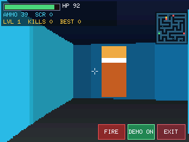
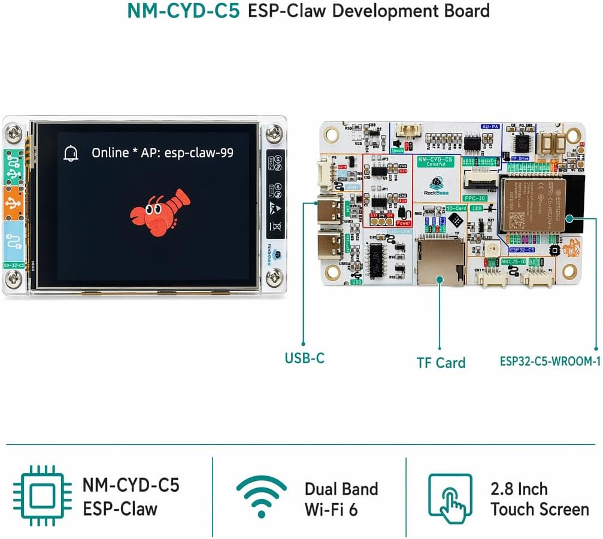

# NM-CYD-C5 Arcade — GameLauncher + 13 ігор на Rust (ESP32-C5)

Аркадна консоль для плати **NM-CYD-C5** (`ESP32-C5`, RISC-V 240 MHz, 16 MB флеш, 8 MB PSRAM,
2.8" TFT 320×240 ST7789, резистивний тач XPT2046, microSD): **GameLauncher** у `factory` + **13 ігор**,
які лежать на microSD і завантажуються в OTA-слот на вимогу.

Усі ігри мають кнопку **`EXIT`** (повернення в лаунчер) і зберігають рекорди на microSD; більшість має
режим **`DEMO`** (автогра). Спільний код плати — бібліотека [`crates/cyd-c5-common`](crates/cyd-c5-common).
Лаунчер також уміє **підключатися до Wi-Fi — і 2.4 ГГц, і 5 ГГц** (див. §11).

```
Лаунчер → вибір гри на microSD → запис .BIN у ota_0 → soft-reset → гра → EXIT → знову лаунчер
```

---

## Демо



Кадри зняті з живого екрана плати (`python3 tools/screenshot.py`):
**GameLauncher** (список 13 ігор на microSD, картка TIC-TAC-TOE) → **CYBER MAZE**
(3D-рейкаст: дрон у прицілі, далі вбитий дрон і `SCR 120`) →
**Checkers** (ШІ проти ШІ) → **Chess** (автогра, `MV: f5c8`) → **Sudoku** (підказки `HINT`) →
**3D Sokoban** (діорама з обертанням камери).
GIF складено власним енкодером на stdlib: `python3 tools/make-gif.py out.gif frame*.png`.

---

## 1. Залізо



*Фото плати — з картки товару продавця (Amazon); права на нього належать продавцю, на код це не поширюється.*

| | |
|---|---|
| плата | **NM-CYD-C5** (RockBase/NMTech), модуль ESP32-C5-WROOM-1 |
| CPU | RISC-V **RV32IMAC**, 240 MHz, **без FPU** (тому в 3D-іграх — фіксована кома) |
| пам'ять | 16 MB SPI-флеш, 8 MB PSRAM, ~320 KB SRAM |
| дисплей | ST7789 320×240, SPI **40 MHz** (`SCK=IO6, MOSI=IO7, MISO=IO2, CS=IO23, DC=IO24, BL=IO25`) |
| тач | XPT2046, `CS=IO1`, 2.5 MHz, афінне калібрування |
| SD | microSD, `CS=IO10`, 400 kHz → 16 MHz |
| консоль | UART0 через CH340: `TX=IO11, RX=IO12`, **115200** → `/dev/ttyUSB0` |

Деталі, схема шини, пастки й розмітка флеша — [`docs/HARDWARE.md`](docs/HARDWARE.md).

---

## 2. Що потрібно встановити

Усе — для **Arch Linux ARM64** (саме на ній проєкт збирається й прошивається). Для інших дистрибутивів
команди ті самі, змінюється лише пакетний менеджер.

```bash
# 1. Базові інструменти
sudo pacman -S --needed base-devel git python3

# 2. Rust + цільовий таргет (rust-toolchain.toml підтягне компоненти сам)
curl --proto '=https' --tlsv1.2 -sSf https://sh.rustup.rs | sh -s -- -y
rustup target add riscv32imac-unknown-none-elf      # RV32IMAC для ESP32-C5
rustup component add rust-src                       # потрібен для build-std

# 3. Прошивальник (обирайте одне)
sudo pacman -S --needed espflash                    # з репозиторію Arch
# або: cargo install espflash --locked              # свіжіша версія, збирається ~5–10 хв
```

Опційно, для ручної роботи з портом:

```bash
sudo pacman -S --needed tio                         # або picocom
sudo usermod -aG uucp "$USER"                       # доступ до /dev/ttyUSB0 (потрібен релогін)
```

`python3` потрібен лише для `tools/pack-sd.py` (пакування образу SD) і `tools/screenshot.py`
(знімок екрана) — **зовнішніх pip-пакетів не потрібно**, тільки стандартна бібліотека.

**ESP-IDF не потрібен.** Репозиторій збирається і прошивається самим лише Rust-тулчейном та `espflash`.

---

## 3. Швидкий старт

```bash
git clone <URL> nm-cyd-c5-arcade && cd nm-cyd-c5-arcade
cargo build --release --workspace       # перша збірка 2–4 хв
```

### Збірка з тестами й пакетом для SD

```bash
bash tools/build-all.sh
```

Що робить:

1. компілює кожен `games/*/src/game.rs` **на хості** (`rustc --test`) і проганяє юніт-тести рушіїв
   (шахи, шашки, судоку, ґомоку, 3D-лабіринт, сокобан тощо) — жодного програмування флеша на цьому кроці;
2. `cargo build --release --workspace` (target `riscv32imac-unknown-none-elf`);
3. експортує образи ігор у `dist/sd/GAMES/*.BIN` (`espflash save-image`) і лаунчер у `dist/cyd-launcher.bin`;
4. пакує `dist/sdseed.bin` — образ розділу `sdseed` з усіма іграми та CRC32.

### Прошивка плати (лаунчер + автоінсталяція ігор на microSD)

```bash
bash tools/flash-all.sh /dev/ttyUSB0              # лаунчер + пакет ігор у sdseed
bash tools/flash-all.sh /dev/ttyUSB0 --no-seed    # лише лаунчер, картку не чіпає
```

`--no-seed` не заливає пакет ігор, тому лаунчер **не** переписує `/GAMES/` на картці — це швидкий
і безпечніший шлях, коли ігри вже встановлені (менше записів = менший ризик пошкодити FAT).

Скрипт робить `build-all.sh`, потім:

```bash
# лаунчер у factory + очищення otadata
espflash flash --chip esp32c5 --port /dev/ttyUSB0 --flash-size 16mb \
  --partition-table partitions.csv --target-app-partition factory \
  --erase-parts otadata target/riscv32imac-unknown-none-elf/release/cyd-launcher

# пакет ігор у розділ sdseed (0x310000)
espflash write-bin --chip esp32c5 --port /dev/ttyUSB0 0x310000 dist/sdseed.bin
```

Після перезавантаження лаунчер побачить у `sdseed` свіжий пакет і **інкрементально** оновить `/GAMES/`
на microSD: файли з тим самим розміром і CRC32 не перезаписуються (у лог іде `без змін`, у підсумку
`записано N, пропущено M`). Оновлення однієї гри = запис ~130 KB замість 1.4 MB. Заміна наявного
файлу йде через `<NAME>.TMP` + перевірку CRC перед підміною, тому обірване живлення не залишає
напів-записаного `.BIN`.

> **Одна гра без лаунчера** (швидка перевірка під час розробки): прошийте крейт гри в `factory` —
> плата стартуватиме одразу з неї. Повернути лаунчер = знову `bash tools/flash-all.sh`.
> ```bash
> espflash flash --non-interactive --chip esp32c5 --port /dev/ttyUSB0 --flash-size 16mb \
>   --partition-table partitions.csv --target-app-partition factory \
>   target/riscv32imac-unknown-none-elf/release/cyd-game-chess
> ```

---

## 4. Ігри

| гра | файл на SD | що це | керування |
|---|---|---|---|
| **Tic-Tac-Toe** | `TTT.BIN` | 3×3 з мінімакс-ШІ | тап по клітинці, `NEW`, `AI:HARD/EASY/2P` |
| **2048** | `G2048.BIN` | класична 2048 з анімацією і ботом | свайпи / стрілки, `NEW`, `DEMO` |
| **Jewels** | `JEWELS.BIN` | match-3 8×8, каскади | свайп/тап, `NEW`, `DEMO` |
| **Zuma** | `ZUMA.BIN` | 3 храмові траси, комбо | прицілювання пальцем, `SWAP`, `PAUS`, `DEMO` |
| **Angry Birds** | `BIRDS.BIN` | рогатка + фізика блоків | тягнути рогатку, `RTRY`, `PAUSE`, `DEMO` |
| **Chess** | `CHESS.BIN` | класичні шахи (FIDE), альфа-бета ШІ | тап/перетягування, `NEW`, `UNDO`, `AI:…`, `DEMO` |
| **Checkers** | `CHECKERS.BIN` | шашки-64: обов'язковий бій, літаючі дамки | тап по шляху серії, `NEW`, `UNDO`, `DEMO` |
| **Sudoku** | `SUDOKU.BIN` | 9×9: генератор з єдиним розв'язком, підказки | цифрова клавіатура, `ERASE`, `HINT`, складність |
| **Gomoku** | `GOMOKU.BIN` | «п'ять у ряд» 10×10, альфа-бета ШІ | тап по полю, `NEW`, `UNDO`, `DEMO` |
| **Cyber Maze** | `CYBERMZ.BIN` | **3D-рейкаст FPS** (лабіринт, дрони, аптечки) | стік зліва, огляд/постріл справа, `FIRE` |
| **3D Sokoban** | `SOKOBAN.BIN` | **3D-діорама**, 50 оригінальних рівнів XSokoban | свайп або D-pad, `ROTATE`, `UNDO`, `RESET` |
| **Swarm** | `SWARM.BIN` | **RTS-lite** у стилі StarCraft: 2 фракції, робітники/ґранти/важкі, база + барак, ШІ | тап по юніту/землі, рамка, `BLD`, `STOP`, `WRK`/`GRT`/`HVY`, `DEMO` |
| **Garden Def** | `GARDEN.BIN` | **tower defense** у стилі Plants vs Zombies: 5 рядів, сонце, 5 рослин, 4 види зомбі, 12 хвиль, косарки | тап по пакету насіння → тап по клітинці; тап по сонцю — зібрати; `DEMO` |

Кнопки `DEMO` (лаунчер і кожна гра) вмикають автогру. `EXIT` зберігає рекорд у `/SAVES/<GAME>.SAV`
і повертає в лаунчер.

### Як додати свою гру

1. скопіювати `games/ttt/` → `games/<name>/`, перейменувати крейт у `Cargo.toml`;
2. логіку тримати в `src/game.rs` **без `std`/`alloc`/`esp-hal`** — тоді вона тестується на хості;
3. додати крейт у `[workspace] members` (кореневий `Cargo.toml`);
4. додати пару `"<name>:games/<name>/src/game.rs"` і `"cyd-game-<name>:<NAME>.BIN"` у `tools/build-all.sh`
   та ім'я файлу в `tools/pack-sd.py`;
5. додати запис у `KNOWN_GAMES` лаунчера (`launcher/src/bin/main.rs`) — заголовок, жанр, порядок, іконка;
6. `bash tools/build-all.sh && bash tools/flash-all.sh /dev/ttyUSB0`.

---

## 5. Архітектура: SD → OTA → EXIT

1. **Розділи** (див. [`partitions.csv`](partitions.csv)): `factory` (лаунчер), `ota_0` / `ota_1` (гра),
   `otadata`, `sdseed` (пакет ігор для автоінсталяції).
2. **Зберігання**: образи ігор — `SD:/GAMES/*.BIN`, рекорди — `SD:/SAVES/*.SAV` (текстом).
   Драйвер `cyd_c5_common::sd` підтримує картки з **MBR**, **GPT** і **Superfloppy** (FAT16/FAT32 без MBR).
3. **Запуск**: лаунчер перевіряє штамп `LaunchStamp` в останньому секторі `ota_0`; якщо ця ж гра вже
   там (кеш за ім'ям + розміром + CRC) — перехід за ~0.65 с без стирання флеша. Інакше — потік
   `/GAMES/<NAME>.BIN` у `ota_0` по 4 KB із прогрес-баром, активація `ota_0` в `otadata`, soft-reset.
4. **Вихід**: `EXIT` пише рекорд у `/SAVES/`, повертає `otadata` на `factory` і перезавантажує чип у
   лаунчер (~130 мс).

Хочете оновити ігри без USB — вставте microSD у кардрідер і скопіюйте `dist/sd/GAMES/*.BIN` у `/GAMES/`
(FAT32, імена у форматі 8.3). Порожня картка + кнопка **`INSTALL SD`** у лаунчері відновить усі ігри з
розділу `sdseed` без комп'ютера. Якщо картка не монтується взагалі (пошкоджений FAT), лаунчер
пропонує **`FORMAT SD`** — форматує її у FAT32 (superfloppy, 32 KB кластери, мітка `GAMES`) і
одразу ставить усі ігри.

---

## 6. Консоль, знімки екрана, команди

Порт: `/dev/ttyUSB0`, **115200 8N1**.

```bash
tio /dev/ttyUSB0 -b 115200          # або: picocom -b 115200 /dev/ttyUSB0
```

**Живий знімок екрана** (без перезавантаження, у будь-якому місці — лаунчер чи гра):

```bash
python3 tools/screenshot.py /tmp/screen.png /dev/ttyUSB0
```

Скрипт надсилає `?`, плата віддає кадр у вигляді `SNAPBEGIN 320 240 … SNAPEND` (hex RGB565), скрипт
зберігає PNG. Друк кадру займає ~20–30 с на 115200 — це нормально.

| де | команди UART |
|---|---|
| лаунчер | `PLAY <NAME.BIN>`, `DEMO <NAME.BIN>`, `RESCAN`, `CLEARSAVES`, `DOWN` / `UP` (прокрутка), `FORMAT` (переформатувати microSD у FAT32) |
| Wi-Fi | `WIFI`, `WSCAN`, `WJOIN <ssid>\|<pass>`, `WDISC`, `WFORGET`, `WSTATUS` — див. §11 |
| будь-яка гра | `X` / `Q` — вихід, `D` — DEMO, `?` — знімок |
| шахи / шашки / ґомоку | `N` — нова партія, `U` — undo, `A` — режим, `>` + хід (напр. `>e2e4`) |
| судоку | `1..9`, `E` — стерти, `H` — підказка, `C` — прибрати помилки |
| cyber maze | `W/S/A/L` — рух/поворот, `F` — постріл |
| 3D sokoban | `2/4/6/8` — рух, `O` — поворот камери, `R` — reset, `P`/`N` — рівень |

---

## 7. Спільна бібліотека `crates/cyd-c5-common`

| модуль | що робить |
|---|---|
| `board` | `Board::init()`: CPU 240 MHz, безпечні CS, ST7789 (`Deg270`), тач, SD, UART, RNG, флеш |
| `spi` | `SharedSpiBus` + `SharedSpiDevice`: одна шина SPI2+DMA, такт перемикається 40 MHz / 2.5 MHz / 400 kHz→16 MHz |
| `fb` | статичний фреймбуфер 320×240 RGB565 у SRAM + `DrawTarget`, `dump_frame_hex()` |
| `touch` | XPT2046: медіана з 3 вимірів, афінне калібрування під `MADCTL 0xA0` |
| `ui` | палітра, шрифти 1 bpp, примітиви, кнопки `draw_btn` / `draw_demo_btn` / `draw_exit_btn`, числа без алокацій |
| `sd` | монтування картки (MBR/GPT/Superfloppy), `/GAMES/*.BIN`, `/SAVES/*.SAV` |
| `boot` | штамп `ota_0`, потокове завантаження `.BIN` зі SD у флеш, розпакування `sdseed`, `exit_to_launcher()` |

---

## 8. Структура репозиторію

```text
.
├── Cargo.toml                 # workspace + спільні залежності (esp-hal 1.2, embedded-graphics …)
├── rust-toolchain.toml        # stable + rust-src + riscv32imac-unknown-none-elf
├── partitions.csv             # 16 MB: factory / ota_0 / ota_1 / sdseed
├── crates/cyd-c5-common/      # спільна бібліотека плати
├── crates/cyd-c5-wifi/        # Wi-Fi-стек лаунчера: esp-radio + esp-rtos + embassy-net + екран
├── launcher/                  # GameLauncher (прошивається у factory, 0x10000)
├── games/<name>/
│   ├── src/game.rs            # чиста логіка (тестується на хості)
│   ├── src/bin/main.rs        # залізо: тач, малювання, UART
│   └── build.rs               # -Tlinkall.x
├── tools/
│   ├── build-all.sh           # хост-тести → збірка → .BIN → sdseed.bin
│   ├── flash-all.sh           # build-all + прошивка лаунчера й пакета ігор
│   ├── pack-sd.py             # пакування dist/sd/GAMES/*.BIN у sdseed.bin (CRC32)
│   ├── screenshot.py          # знімок екрана по UART → PNG
│   ├── make-gif.py            # складання PNG-кадрів у анімований GIF (лише stdlib)
│   └── test-host.sh           # хост-тести всіх рушіїв (викликає build-all.sh і CI)
├── docs/HARDWARE.md           # розпіновка, шина, розмітка флеша, пастки
├── docs/board.png             # фото плати (з картки товару продавця)
├── docs/demo.gif              # демо з живого екрана (див. розділ «Демо»)
├── dist/                      # генерується (у .gitignore)
└── AGENTS.md                  # інструкції для агентів (середовище, збірка, прошивка, інваріанти)
```

---

## 9. Типові проблеми

| симптом | причина / рішення |
|---|---|
| `Unable to acquire exclusive lock` від `espflash` | порт зайнятий (`tio`, монітор, інший `espflash`): `fuser -v /dev/ttyUSB0`, закрити |
| `Permission denied` на `/dev/ttyUSB0` | користувач не в групі `uucp`: `sudo usermod -aG uucp $USER` + релогін |
| Прошивка залилася, але в UART тиша, на `ttyACM0` — `alive N` | `esp-println` зібраний з `auto`: має бути `features = ["uart"]` (див. `docs/HARDWARE.md`) |
| `LAUNCHER: SD недоступна: FsError` (картка є, але не монтується) | FAT пошкоджено (наприклад, живлення зникло посеред запису): у лаунчері — кнопка **`FORMAT SD`** (два тапи: перший «озброює», другий форматує), або UART-команда `FORMAT`. Після форматування лаунчер сам встановлює всі 13 ігор із розділу `sdseed` |
| Дисплей білий / сміття, SD не монтується | не піднято один із CS до старту SPI2, або картка не FAT32/MBR |
| `Tool doesn't match supported version…` при збірці C-проєктів | у шелі одночасно активні ESP-IDF і Rust-toolchain (не стосується цього репозиторію) |
| `cargo build` не бачить `riscv32imac-unknown-none-elf` | `rustup target add riscv32imac-unknown-none-elf` |
| Довга перша збірка (`build-std`) | нормально: перший прогрів 2–5 хв, далі інкрементально секунди |

---

## 10. Як не вбити microSD-картку

Головна причина пошкодження FAT — **обірване живлення посеред запису**. Тому:

1. не вимикати й не висмикувати USB, поки на екрані модал `INSTALLING TO SD` / `FORMAT SD` /
   `запис /GAMES/… (n/11)` — дочекайтесь підсумку `на картці N ігор (записано …, пропущено …)`;
2. стабільне живлення/кабель (просадка напруги псує FAT так само, як від'єднання), перезавантаження —
   через `espflash reset` або RST, а не смиканням кабелю;
3. не виймати картку на ходу і не заливати `sdseed` без потреби — для оновлення лише лаунчера є
   `--no-seed`, а інкрементальна інсталяція переписує тільки те, що справді змінилося;
4. **під час `espflash` картка не захищена**: у режимі ROM-bootloader прошивка не керує `CS` SD
   (`IO10`), а 1.7 MB `sdseed` іде по спільній шині SPI2. Перевірено (2026-11-13): після заливки
   `sdseed` картка перестала монтуватися (`FsError`: сектор 0 читається, том не відкривається) без
   жодного обриву живлення. Тому `tools/flash-all.sh` тепер питає підтвердження перед записом
   `sdseed` (для скриптів — `--yes`), а найбезпечніше — **вийняти картку на час заливки**.
   Якщо картка все ж перестала монтуватися — `FORMAT SD` у лаунчері (два тапи) або UART-команда
   `FORMAT`: усе робиться на платі, кардрідер не потрібен. Перевірено 2026-11-13: форматування
   29.8 GB картки — 61 с, після нього лаунчер сам записав усі 13 ігор із `sdseed` за 11 с.

## 11. Wi-Fi: мережа просто з лаунчера (2.4 + 5 ГГц)

Плата на **ESP32-C5** — дводіапазонна (Wi-Fi 6), тому лаунчер піднімає стек сам: `esp-radio`
1.0.0-beta.1 + `esp-rtos` 0.4 (планувальник, потрібен радіо-блобам) + `embassy-net` (DHCP).
Код — окремий крейт [`crates/cyd-c5-wifi`](crates/cyd-c5-wifi); **ігри Wi-Fi не тягнуть** —
стек компонується лише в лаунчер.

**На екрані**

- у шапці лаунчера — чип `WIFI OFF` / `WIFI ...` / `WIFI 2G` / `WIFI 5G` / `WIFI ERR`
  (тап відкриває екран);
- екран `WI-FI 2.4 + 5 GHz`: статус (фаза, SSID, канал, IP), список мереж (бейдж `2G`/`5G`, канал,
  RSSI, тип захисту), кнопки `SCAN` / `CONNECT` / `DISC` / `FORGET`;
- **тап по закритій мережі одразу відкриває екранну клавіатуру** (`abc` / `123#`, `SHIFT`,
  `SPACE`, `DEL`, `CLR`, `OK`), до 63 символів — підключення починається лише після `OK`;
  відкрита мережа підключається одразу, без клавіатури; кнопка `CONNECT` робить те саме для
  вибраної мережі.

**Діапазони.** `BandMode::Auto` (типово для C5) + країна `UA`: скан іде по каналах 1–13 (2.4 ГГц) і
36–165 (5 ГГц, разом із DFS). Обрана у списку мережа підключається **з фіксацією каналу**
(`StationConfig::with_channel`), тому `DutchWheel 5G` не «зісковзне» на 2.4 ГГц — у списку та сама
мережа видна двічі, окремо `2G` і `5G`.

**Облікові дані** лежать у `SD:/WIFI.CFG` (`SSID=…` / `PASS=…`, відкритим текстом — це звичайна
microSD, не сховище секретів) і записуються **лише після успішного підключення + DHCP**.
**Автопідключення немає:** до закритої мережі лаунчер підключається тільки через екранну
клавіатуру, навіть якщо пароль уже збережено (збережена мережа позначена `*`, а `FORGET` видаляє
файл). Після втрати зв'язку під час сесії — автовідновлення тими самими даними (15 с на спробу,
далі `FAILED` з причиною).

| UART | дія |
|---|---|
| `WIFI` | відкрити / закрити екран |
| `WSCAN` | скан 2.4 + 5 ГГц |
| `WJOIN <ssid>\|<pass>` | підключитись; `\|` — розділювач, без нього — відкрита мережа (регістр зберігається) |
| `WDISC` | відключитись |
| `WFORGET` | видалити `SD:/WIFI.CFG` |
| `WSTATUS` | стан + список мереж + heap у лог |
| `WKB [N]` | діагностика: відкрити клавіатуру для мережі N (без тачу) |
| `WTAP <x> <y>` | діагностика: прогнати тап по координатах (без пальця) |

```bash
printf 'WJOIN MyNet|secret123\n' > /dev/ttyUSB0   # підключитись і зберегти
printf 'WSTATUS\n' > /dev/ttyUSB0                 # перевірити, що дало DHCP
```

**Ресурси.** Стек додає ~610 KB коду: образ лаунчера — **765 KB із 1 MB** розділу `factory`, тому
запас є, але невеликий (перевіряти `espflash save-image` після нових залежностей). Купа — 100 KB
(64 KB reclaimed + 36 KB DRAM), після неї вільного `.stack` ~21 KB.

### Оновлення лаунчера та ігор із GitHub Releases

Лаунчер сам перевіряє релізи й ставить оновлення: `WI-FI` → `UPDATE` (або UART `UPD`).

1. **Перевірка** (`CHECK` / `UCHECK`): `GET https://github.com/<repo>/releases/latest/download/MANIFEST.TXT`
   — маленький текст із версією та CRC32 кожного файла:
   ```text
   version=0.5.0
   launcher cyd-launcher.bin 1180000 1a2b3c4d
   game TTT.BIN 110480 deadbeef
   ```
2. **Порівняння**: ігри — за CRC32 файла на microSD, лаунчер — за версією з app descriptor
   (`Cargo.toml` workspace). У списку видно `OK` / `NEW` для кожного файла.
3. **Встановлення** (`GAMES` / `LAUNCHER`): файл качається в staging-розділ `dl`, перевіряється
   (розмір + CRC32 + ESP-заголовок + `project_name`), і лише потім:
   - гра → `SD:/GAMES/<NAME>.BIN` (штатний шлях із CRC-звіркою);
   - лаунчер → **інший** OTA-слот + `otadata` + reset (завжди є куди повернутися).

**Слоти лаунчера (A/B).** `factory` — «золотий» образ, який по Wi-Fi не перезаписується;
оновлення йдуть у `ota_1`/`ota_2` по черзі. `EXIT` з гри повертає в той слот, з якого гру
запускали (записано у штампі поруч із `ota_0`), тому оновлений лаунчер не «зникає».

| розділ | зміст |
|---|---|
| `factory` (2 MB) | лаунчер, встановлений по USB (недоторканний резерв) |
| `ota_0` (2 MB) | поточна гра (лаунчер пише `.BIN` при запуску) |
| `ota_1`, `ota_2` (2 MB) | A/B-слоти оновленого лаунчера |
| `sdseed` (2 MB) | пакет ігор для автоінсталяції на microSD |
| `dl` (2 MB) | staging завантажень по Wi-Fi |

**Публікація релізу.** Достатньо `git tag vX.Y.Z && git push --tags` — workflow
[`.github/workflows/release.yml`](.github/workflows/release.yml) збирає все і прикріплює ассети
`cyd-launcher.bin`, `MANIFEST.TXT` і `dist/sd/GAMES/*.BIN`. Вручну: `bash tools/build-all.sh`
(створює `dist/MANIFEST.TXT`) і прикріпити ці файли до релізу. Ім'я репозиторію можна змінити в
`SD:/UPDATE.CFG` (`repo=owner/name`).

| UART | дія |
|---|---|
| `UPD` | відкрити екран `UPDATES` |
| `UCHECK` | перевірити релізи |
| `UGAMES` / `ULAUNCHER` | оновити ігри / лаунчер |
| `USTATUS` | стан + список файлів + вільна купа |
| `UURL <owner/repo> <asset>` | діагностика: просто скачати ассет у `dl` (TLS/редірект/швидкість) |

**Безпека.** TLS 1.3 з **повною перевіркою ланцюжка** до пінованих коренів
(`crates/cyd-c5-wifi/src/ca.rs`: USERTrust ECC для github.com, ISRG Root X1 для CDN релізів).
Час для перевірки строків дії береться з SNTP; якщо мережа блокує UDP/123 (типово для готелів) —
з'єднання все одно перевіряється, лише без дат. Завантажене додатково звіряється за CRC32 і
заголовком образу, тому зіпсований/чужий файл у слот не потрапить.

Деталі, пастки й діагностика — [`docs/WIFI.md`](docs/WIFI.md).

---

## 12. Ліцензія й історія змін

Код — **MIT**, див. [`LICENSE`](LICENSE). Історія версій — [`CHANGELOG.md`](CHANGELOG.md).

Рівні гри «3D Sokoban» — класичний набір **XSokoban** (Thinking Rabbit, 1982), поширюється як дані
рівнів у форматі XSB.

CI (`.github/workflows/ci.yml`) на кожен push/PR проганяє хост-тести всіх 11 рушіїв і збирає прошивку
під `riscv32imac-unknown-none-elf`.
